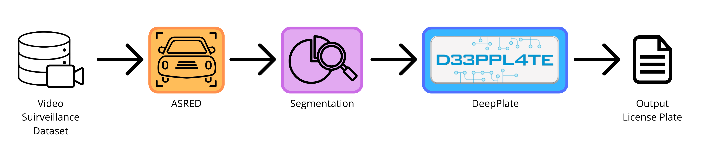

# License Plate Detection and Recognition in Video Surveillance Sequences

The following project implements a complete pipeline for the **localization, segmentation, and recognition of Italian license plates** (LL-DDD-LL format) within surveillance video streams.
The system is designed to be robust and accurate, leveraging advanced computer vision and machine learning techniques to ensure optimal performance even under varying lighting conditions and from different camera angles.

## Dataset and Models
The complete dataset (4K videos + annotations in CVAT XML format) can be downloaded from the following [link](https://unipdit-my.sharepoint.com/:f:/g/personal/nicolo_stefani_3_studenti_unipd_it/IgB3AzMZkmIeR5OmXM2EFHq3AcMnanRRKBbp2Q2TyHYoNdY).

## Pipeline Architecture


The system consists of two main files, plus an experimental variant used for comparison:

### 1. `Pipeline.py` (Core Pipeline & Grid Search)
Manages the entire processing chain:

*   **Detection and Tracking (ASRED):** Runs ASRED on each video to detect and track license plates. Each detection is cropped with a 25% margin around the ASRED bounding box and linked to its track ID, so readings can later be consolidated per physical plate.
*   **Edge Segmentation (Adaptive):** Applies adaptive scaling (targeting a license plate height of 90px) and uses locally calculated multi-threshold Canny algorithms to extract the edges.
*   **Character Refinement:** Reconstructs the exact geometry of the license plate (including tilt and side bands) based on the *baseline* of the detected characters, correcting for perspective distortions.
*   **False Positive Filtering:** Analyzes warm colors (red, amber, burnt yellow) and text structure to filter out headlights, reflectors, and stop signs.
*   **Consolidated OCR:** Integrates **DeepPlate** for character recognition. It consolidates readings over a time window (10 frames) using a weighted score for the most likely character in each frame (weight proportional to confidence × √area), correcting errors in individual frames.

*   **Modes:** Can be run in `pipeline` mode to process videos or in `gridsearch` mode to find the optimal morphological parameters (IoU).

### 2. `Evaluation.py` (Evaluation and Reporting)
Module dedicated to rigorous performance analysis against the *ground truth*:
*   **CVAT Parsing:** Handles complex rotations and object trajectories exported from CVAT.
*   **Localization Metrics:** Calculates TP, FP, FN, Precision, Recall, F1-Score, and IoU at various thresholds.
*   **OCR Analysis:** Measures character-level accuracy (confusion matrix), Levenshtein distance, and evaluates the impact of temporal consolidation compared to single-frame reading.
*   **PDF Report:** Automatically generates a technical report in PDF format containing temporal probability heatmaps and character-by-character visual comparisons.

### 3. Blackhat + Sobel X Variant (`Pipeline_sobel_4k.py`)
Experimental script, used as a baseline for comparison with the adaptive edge segmentation in `Pipeline.py`. It follows the same structure: video → ASRED → cropped images → segmentation → DeepPlate.
*   **Simpler segmentation:** uses morphological Blackhat + Sobel gradient on the X-axis + Otsu threshold to isolate the compact block of the license plate from the rest of the cropped image.
*   **Contour validation:** Rejects contours based on area (relative to the crop) and aspect ratio, distinguishing car license plates (rectangular) from motorcycle license plates (nearly square).

## How to use the code

### Prerequisites
Make sure you have cloned the repository, downloaded the dataset from the link provided above, and configured the global paths within the scripts. To run the code correctly, you need a Python environment with the following packages installed:
*    opencv-python
*    numpy
*    matplotlib


### Running the Pipeline
```bash
# Runs the entire pipeline using the paths set in the Python file
python Pipeline.py

# Runs the grid search on the segmentation parameters (maximizes the mean IoU against the CVAT annotations)
python Pipeline.py gridsearch
> **Note:** the grid search uses the crops and the crop file produced by the pipeline, so the pipeline must be run before this command. 

# Runs the code to evaluate the pipeline output
python Evaluation.py

# Run the code to rescale the bounding boxes generated by CVAT
python RescaleBoundingBox.py input.xml output.xml --preset 4k
python RescaleBoundingBox.py input.xml output.xml --preset 2k

# Run the Blackhat + Sobel X variant
python Pipeline_sobel_4k.py

```
